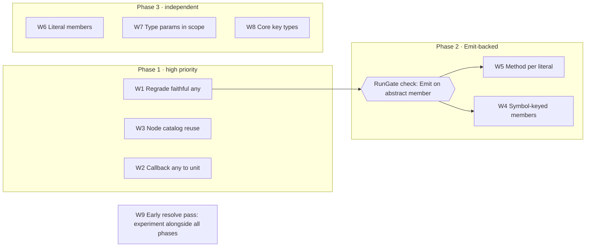

# Xantham: Widening and Escape Reduction Specification

2026-10-13 · Shayan · Living copy: [Claude doc](https://claude.ai/code/artifact/cf5a449e-6f62-4906-a601-0ed1eb15dcc6)

This specification defines nine workstreams, W1 to W9, that reduce widened and escaped findings in Xantham's generated bindings. Every decision was taken in review of [Xantham: What Widens and Escapes](https://claude.ai/code/artifact/7abd449e-bc37-46dd-8635-4fa62afe096c). Every open question was settled by a compile-and-run probe on 2026-10-13 (section 6).

## 1. Purpose and scope

The baseline below comes from the committed `symbols.jsonl` files of Xantham.Fable.Core.TS, Xantham.Fable.Node and the five real-package goldens. Lab goldens are excluded.

| Measure | Baseline |
| --- | --- |
| Escaped symbols | 1,241, with TR008 the sole cause for 1,221 |
| Widened symbols | 2,025 |
| Widened and escape findings | 45,158 |
| TR008 findings from DOM `on*` handler returns | 16,017 |

**In scope:**

- generator passes (Harvest, Resolve, Shape, Render)
- finding grades in `Findings.fs`
- the Core.TS catalog and its reuse by Node
- generator configuration
- references to `Xantham.Fable.Core` key types

**Out of scope:** changes that require Fable upstream, which are listed in section 8.

## 2. Definitions

| Term | Meaning |
| --- | --- |
| Grade | A finding's tier: exact, ergonomic, widened or escape, recorded per symbol in `manifest.json` |
| Faithful `obj` | An `obj` emitted for a source `any`, where the source states no narrower type |
| Stated-type loss | An `obj` emitted in place of a type the source declares, such as an uncatalogued reference |
| Literal member | A required member, readonly or writable, whose declared type is a single string or numeric literal, such as `readonly AT_TARGET: 2` or `kind: "method"`. Optional ones stay `Create` parameters |
| Literal overload | An overload whose discriminating parameter is a string literal, such as `on(event: "close", …)` |
| Key type | `keyof<'T>`, `typekeyof<'T, 'R>`, `proptypelock<'T>` or `proptypekey<'T, 'R>` from `Xantham.Fable.Core` |
| Probe | A scratch Fable 5.2.0 project compiled with Fable 5.17.2 and run under node, recorded in section 6 |

## 3. Goals

The specification is met when the escape tier holds only stated-type losses, and every workstream meets its acceptance criteria in section 4.

- **Escape means a lost stated type.** A faithful `any` → `obj` no longer grades escape. In W1's selected goldens, no TR008 finding grades escape. Corpus-wide totals are measured at integration.
- **Each workstream states the codes it removes.** Its lab fixture tests assert the exact finding changes. In the regenerated goldens, those codes fall by about the stated scale. New codes may appear there as previously escaped types are now resolved further; each is read in the golden diff and noted in the phase record.
- **Every change is visible in the goldens.** A behaviour change lands with its golden diff read and committed, the CompileGate green, and the phase record in `docs/.ai/plans/` updated in the same commit.
- **Emitted runtime shapes are proven.** Any new `[<Emit>]` form gets a RunGate check before it is applied corpus-wide.

## 4. Requirements

Each workstream lists numbered requirements, its acceptance criteria and the probes that support it. Requirement numbers are stable references for commits and phase records.

| # | Workstream | Codes | Scale | Priority |
| --- | --- | --- | --- | --- |
| W1 | Regrade faithful `any` | TR008 grade | 1,221 escaped symbols | High |
| W2 | Author-selected `=> any` returns as `unit` | TR008 | \~16,000 findings | High |
| W3 | Node reuse of Core.TS ES types | TR023, part of TR035 | \~800 findings | High |
| W4 | Symbol-keyed members | MB002 | 472 findings | High |
| W5 | One method per literal overload | TR006, DO001 | \~5,000 + \~1,900 findings | Normal |
| W6 | Literal members: module, docs and Create | TR007 | 164 symbols, \~6,500 findings | Normal |
| W7 | Type parameters in scope | TR012, TR013, TR027, TP006 | \~350 symbols | Normal |
| W8 | Key types for aliases and tag maps | SA002, TR020, TR044, DO005 | \~1,500 tag-map findings, plus type-fest aliases | Normal |
| W9 | Early resolve pass | TR045 | 131 `InstanceType` findings | Experiment |

### W1. Regrade faithful any

- **W1.1** TR008 (`any` → `obj`) grades **ergonomic**. Its `FindingCodes.table` key is unchanged.
- **W1.2** Escape is reserved for stated-type losses, such as TR063 (an unresolved reference) and TR064 (an `intrinsic` alias body).
- **W1.3** W1.1 applies to rest-argument listeners: `(...args: any[]) => void` → `obj[] -> unit`.
- **Acceptance:** the lab asserts TR008 at ergonomic, a rest-argument listener, a TR063 that stays escape, and a row that stays escape when TR008 sits beside a TR063. In `animejs` and `workers-types`, no TR008 finding grades escape.
- **Status:** merged to `develop` in #141 (2026-10-13). Escape counts fell from 79 to 6 in `animejs`, from 111 to 1 in `workers-types`, and from 42 to 1 in `solid-js`.

### W2. Author-selected => any returns as unit

- **W2.1** Generator configuration accepts a member-name pattern, a filter or regex, that selects which callback `=> any` returns emit as `unit`. Unselected members remain `obj`.
- **W2.2** The Core.TS configuration selects `^on` for event-handler properties.
- **W2.3** A selected return grades ergonomic, with a finding that records the source `any`.
- **Acceptance:** the lab asserts a selected `on*` handler as `(ProgressEvent -> unit) option` and an unselected member as `obj`. In `animejs` and `workers-types`, output is unchanged unless their configuration sets a pattern.
- **Status:** merged to `develop` in #143 (2026-10-13). The key is `anyReturnAsUnit`, one .NET regular expression; a selected return reports `TR065`. `animejs` and `workers-types` are unchanged; `animejs` under `^on` moves 257 findings from `TR008` to `TR065`. Core.TS, regenerated under the T4 override, moves 15,987.

### W3. Node reuse of Core.TS ES types

`SharedArrayBuffer`, `Iterable`, `ArrayIterator`, `AsyncGeneratorFunction`, `RegExp` and `ArrayLike` are all generated in Core.TS. Node still reports them as "not among the generated declarations". The fault is in catalog reuse, not generation.

- **W3.1** Find why Node does not reuse these Core.TS catalog entries, and record the cause in `docs/.ai/footguns.md`.
  - **Ruled out:** `@types/node` does not re-declare these names. Its compatibility shims merge into `Disposable`, `AsyncDisposable`, `SymbolConstructor`, the typed arrays and `IteratorObject`.
  - **Partial lead:** Node loads `lib="es2020"`. `SharedArrayBuffer` and `RegExp` have declarations in later lib files (es2022, es2024), so their declaration sets differ between the two programs. That cannot explain `ArrayLike`, `Iterable`, `ArrayIterator` or `AsyncGeneratorFunction`. Each of those is declared in a single lib file within es2020.
  - **Confirmed cause:** Node does not consult the Core.TS catalogue. It lists no `declarationReferences`, so its compiler lib takes the default `widen`, and its es2020 inference profile could never match Core.TS's `esnext`/`dom` ship profile. Under `widen`, `Shape.libBinding` names a compiler-lib type only through `Naming.LibBindings` or, for DOM files, `Fable.Core.TS.Dom`. ECMAScript names outside the table widen with TR023 (`docs/.ai/footguns.md`, "Declaration catalogs").
- **W3.2** Fix catalog reuse so that Node references the Core.TS types.
  - **Satisfied without catalog reuse:** under `widen`, a compiler-lib ECMAScript declaration outside `Naming.LibBindings` is written as `Fable.Core.TS.Es.{name}`, as DOM declarations already are. The lab is `es-reuse-lab`, a single consumer package compiled against Core.TS by the compile gate. Measured deltas are in `generator-architecture.md`, "ECMAScript consumer bindings".
- **Acceptance:** `es-reuse-lab`, a single widen-mode consumer on @types/node's es2020 program, references `ArrayLike` and `ArrayBufferLike` with no TR023 or TR035, and the compile gate builds its golden against Core.TS. This single-package lab replaces the two-package lab modelled on `cross-package-lab` (lead decision, 2026-10-13): `Shape.libBinding` keys on the compiler-lib origin and the `typescript/lib` disposition, not on the referencing group, so a dependent package adds no route. A dependency under its own `reference`, `map` or `widen` disposition that references these names is not covered by a lab. In `workers-types` and `solid-js`, TR023 and TR035 do not rise. Node holds nearly all of W3's hits, so a Node regeneration under override T4 is expected.
- **Status:** merged to `develop` in #145 (2026-10-13). In `workers-types`, TR023 falls from 37 to 9 and TR035 from 11 to 6; in `solid-js`, TR023 falls from 6 to 0. Consumers write every standard-library name except `Error` and `Promise`/`PromiseLike` as `Fable.Core.TS.Es.<Name>`; Core.TS writes `Promise` as `JS.Promise`; `CatalogCompatibility.ApiVersion` is 7. Node, regenerated under the T4 override, moves TR023 from 737 to 149.

### W4. Symbol-keyed members

- **W4.1** Symbol-keyed members are emitted.
- **W4.2** `[Symbol.iterator]` is expressed as `inherit seq<'T>` (probe 7).
- **W4.3** Other well-known symbols emit as named members through `[<Emit>]`, such as `[<Emit("$0[Symbol.dispose]()")>]` and the getter `[<Emit("$0[Symbol.toStringTag]")>]` (probe 7).
- **Acceptance:** the lab asserts a non-empty `Disposable`, an iterable that iterates without a cast, and a `toStringTag` getter. A RunGate check covers one Emit-backed symbol member. In `workers-types` and `type-fest`, MB002 falls.
- **Status:** merged to `develop` in #144 (2026-10-13). `[Symbol.iterator]` reports `MB008` and another well-known symbol member `MB009`. In `workers-types`, MB002 falls from 10 to 0; `type-fest` is unchanged. Core.TS, regenerated under the T4 override, moves MB002 from 202 to 0.

### W5. One method per literal overload

- **W5.1** The generic overload, `on(event: string, …)`, is kept.
- **W5.2** Each literal overload becomes its own method, named as the method name plus the literal in PascalCase (`onClose`). On a collision with an existing member, `_` separates the parts (`on_Close`).
- **W5.3** Each such method carries `[<Emit("$0.on('close', $1)")>]` and an XML doc with the TypeScript signature. Curried listeners need no delegate: `string -> float -> unit` is called as `(host, port)` (probe 6).
- **W5.4** W5.2 and W5.3 apply to every literal-keyed method, including `on`, `once`, `addListener`, `prependListener` and `prependOnceListener`.
- **Acceptance:** the lab asserts a `Socket`-shaped emitter with listener shapes that collide today, a name collision (`on_Close`), and no DO001 or TR006 on them. The RunGate holds an Emit-on-abstract-member check. In `workers-types` and `animejs`, TR006 and DO001 fall.
- **Status:** merged to `develop` in #146 (2026-10-14). A literal overload reports `MB010`; `CatalogCompatibility.ApiVersion` is 8. TR006 falls from 228 to 221 in `workers-types` and from 21 to 20 in `animejs`, where DO001 falls from 1 to 0. Core.TS and Node are regenerated under the T4 override: Core.TS reads 784 methods (`MB010`) and TR056 falls from 786 to 0; in Node, TR006 falls from 5,063 to 673 and DO001 from 1,904 to 27.

### W6. Literal members: module, docs and Create

- **W6.1** The required single-literal members of a type, readonly or writable, get a same-named module of `[<Literal>]` values (`Event.AT_TARGET = 2.`). This includes types that also have methods. In `module rec`, the module sits beside `[<Interface>] type Event` without breaking `Event.Create` (probe 8).
- **W6.2** The interface keeps its literal members for instance access (`e.AT_TARGET`), each with an XML doc giving its TypeScript literal type.
- **W6.3** A `[<ParamObject>] Create` leaves literal members, including inherited ones, out of its parameters and writes them into its Emit, wrapped in parentheses (probe 10):
  - discriminant: `[<ParamObject; Emit("({ kind: 'method', ...$0 })")>]`
  - constants: `[<ParamObject; Emit("({ NONE: 0, CAPTURING_PHASE: 1, AT_TARGET: 2, BUBBLING_PHASE: 3, ...$0 })")>]`
- **W6.4** String literal values are written in the Emit as escaped JavaScript string literals.
- **Acceptance:**
  - The lab asserts an `Event`-shaped type with methods and numeric constants, a subtype that inherits them, a string discriminant, and a value that needs escaping.
  - The RunGate checks that `match e.eventPhase with | Event.AT_TARGET` compiles to `e.eventPhase === 2`, and that a subtype's `Create` takes no constant parameters.
  - In `solid-js` and `animejs`, TR007 falls.
- **Status:** merged to `develop` in #147 (2026-10-14). A literal member reports `MB011` and a `Create` that writes literals `SP005`. Lead amendment: a required single-literal member is a literal member whether readonly or writable; optional ones stay `Create` parameters. A subtype's module holds its own literal members only; inherited constants are read through the base's module. TR007 falls from 54 to 0 in `solid-js` and from 18 to 0 in `animejs`; TR006 falls from 221 to 77 in `workers-types`. Core.TS and Node are regenerated under the T4 override: TR007 falls from 6,494 to 0 in Core.TS and from 86 to 0 in Node.

### W7. Type parameters in scope

- **W7.1** A callback hoisted into a named delegate takes its owner's type parameters.
- **W7.2** The delegate repeats a constraint only when the constraint type is an interface or class. An erased-union constraint such as `ArrayBufferLike` (`U2<ArrayBuffer, SharedArrayBuffer>`) is sealed and rejected by F# (FS0698, probe 5). Such a parameter stays unconstrained, as its owner `BigInt64Array<'TArrayBuffer>` already is.
- **W7.3** Global and namespace functions emit as methods. Code that reassigns a global function uses unsafe primitives.
- **W7.4** A method type parameter keeps the constraint its use site needs: `querySelectorAll<'E when 'E :> Element>: selectors: string -> NodeListOf<'E>`. Inside a function, `'E` is inferred from how the result is used. A module-level binding states `'E`, because F# has no form of TypeScript's `= Element` default (FS0030, probe 4).
- **Acceptance:** the lab asserts each of the following, all compiled by the CompileGate:
  - a hoisted delegate with an interface constraint and with a union constraint
  - a generic global function
  - a constrained namespace function
  - a method type parameter used only in its return

  In `solid-js` and `animejs`, TR012, TR013, TR027 and TP006 fall.
- **Status:** merged to `develop` in #148 (2026-10-14). In `animejs`, TR012 falls from 2 to 0, TR013 from 3 to 0, TR027 from 1 to 0 and TP006 from 1 to 0; in `solid-js`, TR013 falls from 23 to 15. Core.TS and Node are regenerated under the T4 override: in Core.TS, TR012 falls from 190 to 0, TR027 from 152 to 0 and TP006 from 154 to 2; in Node, TR012 falls from 102 to 0 and TR013 from 250 to 19. `Store.DEV.isWrappable` (a readonly property typed `typeof f`, TR013) is left for a follow-up.

### W8. Key types for aliases and tag maps

`Xantham.Fable.Core` supplies the key types. W8 emits references to them.

| TypeScript | Emitted as | Meaning |
| --- | --- | --- |
| `keyof T` | `keyof<'T>` | An erased string key of `'T`, built as `keyof _.Prop` |
| `T[K]` for one key, and tag-map lookups | `typekeyof<'T, 'R>` | The key plus its value type. `TypeKeyOf.item` reads it as `'R` |
| `T[keyof T]`, such as type-fest `ValueOf<T>` | `proptypelock<'T>` | Any one property type of `'T`, unlocked to a specific type by a `proptypekey` |
| `{ [P in keyof T]: V }` | `PropertyRecord<'T, 'V>` | An indexer keyed by `keyof<'T>` |
| Index signatures | `Record`, `ReadonlyRecord` | Unchanged |

- **W8.1** Tag-map methods take a `typekeyof` key and return its value type: `createElement: tagName: typekeyof<HTMLElementTagNameMap, 'E> * ?options: ElementCreationOptions -> 'E`. The key erases to the tag string, `createElement("canvas")` (probe 2).
- **W8.2** The deprecated-tag overload is a second overload keyed by `typekeyof<HTMLElementDeprecatedTagNameMap, 'E>`, and is no longer dropped (DO005).
- **W8.3** Where a method has more than one key overload, callers name the map: `typekeyof<HTMLElementTagNameMap, _> _.canvas`. This is the accepted calling form. With a single key overload, `typekeyof _.canvas` infers it alone (probe 1).
- **W8.4** A tag-map method whose result type is constrained carries the constraint on its own type parameter: `getElementsByTagName<'E when 'E :> Element>` returns `HTMLCollectionOf<'E>` (probe 3).
- **W8.5** Type-level aliases with a Core counterpart emit that counterpart (`ValueOf<T>` → `proptypelock<'T>`). Others remain phantoms.
- **Acceptance:** the lab asserts two tag maps with a primary and a deprecated overload, a constrained result, and a `ValueOf`-style alias. The RunGate checks that the key emits the bare tag string. In `type-fest` and `solid-js`, SA002, TR020, TR044 and DO005 fall.
- **Status:** merged to `develop` in #149 (2026-10-14; `tag-map-lab`, codes `TR066`, `TR067` and `TP011`), including the `PropertyRecord` row. A tag map's result type parameter is `'E`, the W8.1 spelling; a key over an in-scope operand keeps `'R`. The map-key form applies to every key over a declared map, Core.TS's `addEventListener` overloads included. **The selected-golden acceptance is not met** and is open for the lead: `type-fest` SA002 170 → 169 (`Stringified`, the one key-independent mapped alias) and TR020 8 → 7; `solid-js` is unchanged (its accesses are bounded by its own `KeyOf` alias and `T[number]`); TR044 and DO005 were already 0 in both. The Core.TS figures in the W8 phase record of `generator-architecture.md` (TR044 1,209 → 5, DO005 17 → 0) are offered as alternative evidence, pending the lead's decision. At integration, `animejs` moves too (TR020 17 → 0, DO005 13 → 0, TP011 0 → 20), and Core.TS, regenerated under the T4 override, measures TP011 0 → 3,170, TR044 1,209 → 5 and DO005 17 → 0; Node's findings do not move.

### W9. Early resolve pass (experiment)

- **W9.1** Before Resolve, ask the checker for the resolved type of each reference whose alias is generic but whose arguments are concrete, such as `InstanceType<typeof IncomingMessage>`. Later passes then see `IncomingMessage`.
- **W9.2** The Wire session already exposes `getTypeAtLocation`, `typeToString` and `getTypeOfSymbol`, and Resolve already calls `getTypeAtLocation` (probe 9).
- **Outcome:** a written finding on whether the approach holds. It is measured on a lab that reproduces `http.RequestListener`'s `InstanceType` use, and on TR045 deltas in `type-fest` and `solid-js`. W9 does not commit to shipping.
- **Status:** merged to `develop` in #150 (2026-10-14), as the opt-in `resolveConditionalConstraints` flag, off by default and not set for Node. A conditional deferred over a bounded type parameter reads its value at the bound under `TR068` (Widened); W8 holds `TR066` and `TR067`. With the flag off, no golden, Core.TS or Node moves; `early-resolve-lab` sets it. Measured on a scratch Node with the flag on, all 130 `InstanceType` TR045 sites move to TR068 (`2026-10-13-w9-early-resolve-findings.md`); adopting it for Node is a follow-up.

## 5. Sequencing and verification

W1 lands first, because the escape baseline it resets is what every later delta is measured against. W4 and W5 each add their RunGate check alongside the change. Probe 6 has already shown that Emit on an abstract member behaves correctly. W6, W7 and W8 are independent. W9 runs alongside the other workstreams.

### Test constraints

These rules govern every test run for W1–W9. For these work items they replace the "run everything before commit" rule in `.claude/rules/generator-fixtures.md`. The labs carry the proof. Goldens confirm the change at scale on the packages it hits most.

| # | Rule |
| --- | --- |
| T1 | The full corpus is never run: no unfiltered `build.fsx -- test`, and no regeneration of every golden |
| T2 | Each requirement is proven first on a lab fixture (`tests/fixtures/<feature>-lab/`) and per-pass unit tests. The lab test asserts the exact finding changes, including the negatives |
| T3 | Only after the lab passes, the workstream regenerates its two selected goldens, listed below: `dotnet fsi build.fsx -- test --quick --update --filter "generator e2e.<golden>"`. Acceptance is measured as code deltas in those goldens |
| T4 | Core.TS and Node are not regenerated. Override: the implementer may regenerate one when the selected goldens cannot show the change, and records the reason in the sub-issue |
| T5 | Any runtime, RunGate, compile or unit test that a requirement needs may be written and run, including `--run-gate` for a new Emit form |
| T6 | While a work item is in progress, unselected goldens are not regenerated. When its pull request is created, every test golden is regenerated with `dotnet fsi build.fsx -- test --goldens` (the write pass only, limited to golden test cases) and the regenerated diff is reviewed; the full suite is not run. Core.TS and Node remain under T4 |

`--filter` matches a prefix of the `.`-joined full test name, not a substring, and a filter that matches no test exits 0. A lab registered under its own test list (`catalog subpath fixture`, `augmented DOM fixture`) takes that list's name. Every filtered run must report a passed count greater than 0.

Goldens are selected as the two test goldens with the most hits for the workstream's codes, counted from the committed `symbols.jsonl` on 2026-10-13. A tie goes to the golden with fewer symbols.

| WS | Codes counted | Golden 1 (hits) | Golden 2 (hits) |
| --- | --- | --- | --- |
| W1 | TR008 | `animejs` (392) | `@cloudflare/workers-types` (168) |
| W2 | TR008 on `on*` members | `animejs` (257) | `@cloudflare/workers-types` (5) |
| W3 | TR023, TR035 | `@cloudflare/workers-types` (48) | `solid-js` (41) |
| W4 | MB002 | `@cloudflare/workers-types` (10) | `type-fest` (2, tie with `solid-js`) |
| W5 | TR006, DO001 | `@cloudflare/workers-types` (230) | `animejs` (22) |
| W6 | TR007 | `solid-js` (54) | `animejs` (18) |
| W7 | TR012, TR013, TR027, TP006 | `solid-js` (38) | `animejs` (7, tie with `workers-types`) |
| W8 | SA002, TR020, TR044, DO005 | `type-fest` (178) | `solid-js` (80) |
| W9 | TR045 | `type-fest` (154) | `solid-js` (56) |

`ansi-regex` and `cross-package-dep` have no hits and are never selected. W3 and W4 have few golden hits, so their labs carry the proof, and W3 is expected to use the T4 override for Node.

Each workstream follows these steps:

1. Write the lab fixture and unit tests, run them, and see them fail for the right reason (T2).
2. Implement the change until the lab and unit tests pass: `dotnet fsi build.fsx -- test --quick --update --filter "generator e2e.<feature>-lab"`.
3. Regenerate the two selected goldens (T3). Read the code counts from their `manifest.json` and grep `symbols.jsonl` for specific findings. Large golden diffs are not read in full.
4. Run the tests the requirements need (T5) and keep `dotnet build Xantham.slnx` (the CompileGate) green.
5. Update the phase record in `docs/.ai/plans/` in the same commit, with the lab results and golden deltas.

## 6. Evidence

The probes ran on 2026-10-13. Each was a scratch project against Fable.Core 5.2.0, Core.TS and Xantham.Fable.Core, compiled with Fable 5.17.2 and run under node against mock objects. Probes 1, 4 and 5 found compile limits, which are now written into W7 and W8. Every runtime check passed.

| # | Question | Result | Used by |
| --- | --- | --- | --- |
| 1 | Does `typekeyof _.canvas` infer without an annotation? | With one key overload, yes. With two, FS0041, so callers name the map | W8.3 |
| 2 | What does a `typekeyof` key emit? | The bare tag string: `createElement("canvas")`, `createElement("marquee")` | W8.1 |
| 3 | Does `getElementsByTagName` type through the key? | Yes: `HTMLCollectionOf<HTMLInputElement>`, emitted as `getElementsByTagName("input")` | W8.4 |
| 4 | Does `querySelectorAll`'s `'E` resolve unannotated? | Inside a function, yes. A module-level binding fails with FS0030 | W7.4 |
| 5 | Can a delegate keep `'TArrayBuffer :> ArrayBufferLike`? | No. The constraint is the sealed `U2<ArrayBuffer, SharedArrayBuffer>` (FS0698) | W7.2 |
| 6 | Does `[<Emit>]` work on an abstract member? | Yes: `socket.on('close', …)`. A curried two-argument listener is called as `(host, port)`, and a `unit` listener with no arguments | W5.3 |
| 7 | Do symbol members work? | `inherit seq<string>` iterates a JS iterable in `for … in` and `Seq.toArray`. The `Symbol.dispose` call and `Symbol.toStringTag` getter Emits work | W4.2, W4.3 |
| 8 | Can a `[<Literal>]` module sit beside its interface in `module rec`? | Yes. The match compiles to `e.eventPhase === 2`, and `Create` still resolves | W6.1 |
| 9 | Can W9 start without Wire changes? | Yes. The checker calls are exposed, and Resolve already calls `getTypeAtLocation` | W9.2 |
| 10 | Does a Create with literals in its Emit work? | Yes, in every position, and subtypes carry inherited constants. Statement position needs the Emit in parentheses; without them it fails with `SyntaxError: Unexpected token '...'` | W6.3 |

## 7. Unaddressed items

No items remain open. W3.1's cause is confirmed and recorded in `docs/.ai/footguns.md`. Every question raised in review is recorded below with its decision.

| Question | Decision | Recorded in |
| --- | --- | --- |
| Ergonomic or exact for a faithful `any`? | Ergonomic | W1.1 |
| Is Node's rest-argument listener covered? | Yes, by the W1 regrade | W1.3 |
| Is one method per literal per listener method an acceptable surface (about 13 × 6 on `Socket`)? | Yes | W5.4 |
| Does the constants module apply to types that also have methods? | Yes | W6.1 |
| Should Create carry literal members? | Yes: in the Emit, removed from the signature | W6.3 |
| Does a `typekeyof` call need an annotation? | Accepted where there are several key overloads | W8.3 |
| Does the key cover `getElementsByTagName`? | Yes | W8.4 |
| Can `querySelectorAll` keep `'E`'s constraint? | Yes. A module-level binding states `'E` | W7.4 |
| May a work item run the full corpus? | No. Lab first, then two selected goldens | T1–T3 |
| Are Core.TS and Node selectable goldens? | No, test goldens only, with an implementer override | T4 |
| How is acceptance verified without a full run? | Per selected golden | Section 4 acceptance, T3 |
| How many goldens per workstream? | The top two by hit count | Section 5 selection table |
| Standalone discriminant interfaces, `string \| symbol` keys, type-guard narrowing | Deferred | Section 8 |

## 8. Deferred items

These were deferred in review. Each is scheduled after this specification lands.

| Item | Codes | Reason | Next step |
| --- | --- | --- | --- |
| Myriad for type-level results (`IsEqual`, `UnionToIntersection`) | TR045, SA002 | Value beyond constraint use is unclear. Myriad reads F# input, so it needs its own model of TS type logic | Separate investigation |
| Generic namespace functions with conditional returns (`Reflect.get`) | TR012, TR013, TR045 | Needs further design. Myriad is a candidate | After W7 |
| Xantham `unique symbol` representation, offered upstream | TR042 | Semantics to be found by experiment (owner: Shayan) | Experiment, then propose to Fable |
| `string \| symbol` event keys collapse to `obj` | TR041, TR035 | Depends on the `unique symbol` representation | After that representation |
| Upstream: `IDisposable` also emits `[Symbol.dispose]` | MB002 | Requires a Fable change | Propose after W4 |
| Standalone discriminant interfaces (`kind: "method"`, workers-types `type: "alarm"`) | TR006, TR007 | Tagged-union form or one-case string enum is undecided. W6.3 already writes the discriminant into Create | Decide after W6 |
| Type-guard narrowing (`error is Error` → `bool`) | TR009 | The guard function carries the intent. Narrowing is hard to generalise | Revisit on demand |
| Configurable case and name templates for W5 methods | — | Optional once the default naming is proven | After W5 |
