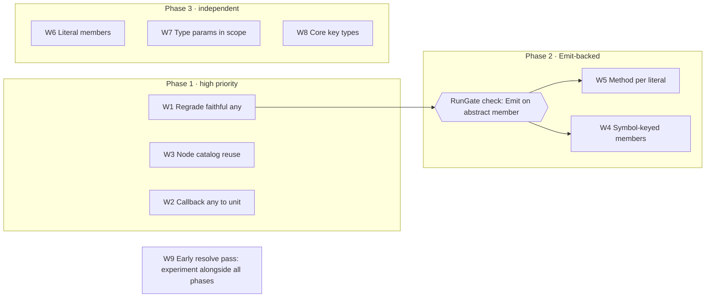

# Xantham: Widening and Escape Reduction Specification

2026-10-13 · Shayan · Living copy: [Claude doc](https://claude.ai/code/artifact/cf5a449e-6f62-4906-a601-0ed1eb15dcc6)

This specification defines nine workstreams, W1 to W9, that reduce widened and escaped findings in Xantham's generated bindings. Every decision was taken in review of [Xantham: What Widens and Escapes](https://claude.ai/code/artifact/7abd449e-bc37-46dd-8635-4fa62afe096c). Every open question was settled by a compile-and-run probe on 2026-10-13 (section 6).

## 1. Purpose and scope

The baseline below comes from the committed `symbols.jsonl` files of Xantham.Fable.Core.TS, Xantham.Fable.Node and the five real-package goldens. Lab goldens are excluded.

| Measure | Baseline |
| --- | --- |
| Escaped symbols | 1,241, with TR008 the sole cause for 1,221 |
| Widened symbols | 2,025 |
| Widened and escape findings | 45,158 |
| TR008 findings from DOM `on*` handler returns | 16,017 |

**In scope:**

- generator passes (Harvest, Resolve, Shape, Render)
- finding grades in `Findings.fs`
- the Core.TS catalog and its reuse by Node
- generator configuration
- references to `Xantham.Fable.Core` key types

**Out of scope:** changes that require Fable upstream, which are listed in section 8.

## 2. Definitions

| Term | Meaning |
| --- | --- |
| Grade | A finding's tier: exact, ergonomic, widened or escape, recorded per symbol in `manifest.json` |
| Faithful `obj` | An `obj` emitted for a source `any`, where the source states no narrower type |
| Stated-type loss | An `obj` emitted in place of a type the source declares, such as an uncatalogued reference |
| Literal member | A readonly member whose declared type is a single string or numeric literal, such as `readonly AT_TARGET: 2` |
| Literal overload | An overload whose discriminating parameter is a string literal, such as `on(event: "close", …)` |
| Key type | `keyof<'T>`, `typekeyof<'T, 'R>`, `proptypelock<'T>` or `proptypekey<'T, 'R>` from `Xantham.Fable.Core` |
| Probe | A scratch Fable 5.2.0 project compiled with Fable 5.17.2 and run under node, recorded in section 6 |

## 3. Goals

The specification is met when the escape tier holds only stated-type losses, and every workstream meets its acceptance criteria in section 4.

- **Escape means a lost stated type.** A faithful `any` → `obj` no longer grades escape. Escaped symbols fall from 1,241 to about 20, the escapes that TR008 does not cause.
- **Each workstream states the codes it removes.** Its lab fixture tests assert the exact finding changes. In the regenerated goldens, those codes fall by about the stated scale. New codes may appear there as previously escaped types are now resolved further; each is read in the golden diff and noted in the phase record.
- **Every change is visible in the goldens.** A behaviour change lands with its golden diff read and committed, the CompileGate green, and the phase record in `docs/.ai/plans/` updated in the same commit.
- **Emitted runtime shapes are proven.** Any new `[<Emit>]` form gets a RunGate check before it is applied corpus-wide.

## 4. Requirements

Each workstream lists numbered requirements, its acceptance criteria and the probes that support it. Requirement numbers are stable references for commits and phase records.

| # | Workstream | Codes | Scale | Priority |
| --- | --- | --- | --- | --- |
| W1 | Regrade faithful `any` | TR008 grade | 1,221 escaped symbols | High |
| W2 | Author-selected `=> any` returns as `unit` | TR008 | \~16,000 findings | High |
| W3 | Node reuse of Core.TS ES types | TR023, part of TR035 | \~800 findings | High |
| W4 | Symbol-keyed members | MB002 | 472 findings | High |
| W5 | One method per literal overload | TR006, DO001 | \~5,000 + \~1,900 findings | Normal |
| W6 | Literal members: module, docs and Create | TR007 | 164 symbols, \~6,500 findings | Normal |
| W7 | Type parameters in scope | TR012, TR013, TR027, TP006 | \~350 symbols | Normal |
| W8 | Key types for aliases and tag maps | SA002, TR020, TR044, DO005 | \~1,500 tag-map findings, plus type-fest aliases | Normal |
| W9 | Early resolve pass | TR045 | 131 `InstanceType` findings | Experiment |

### W1. Regrade faithful any

- **W1.1** TR008 (`any` → `obj`) grades **ergonomic**. Its `FindingCodes.table` key is unchanged.
- **W1.2** Escape is reserved for stated-type losses, such as TR023.
- **W1.3** W1.1 applies to rest-argument listeners: `(...args: any[]) => void` → `obj[] -> unit`.
- **Acceptance:** escaped symbols across the corpora fall to about 20.

### W2. Author-selected => any returns as unit

- **W2.1** Generator configuration accepts a member-name pattern, a filter or regex, that selects which callback `=> any` returns emit as `unit`. Unselected members remain `obj`.
- **W2.2** The Core.TS configuration selects `^on` for event-handler properties.
- **W2.3** A selected return grades ergonomic, with a finding that records the source `any`.
- **Acceptance:** Core.TS emits `onabort: (ProgressEvent -> unit) option`, and the 16,017 handler-return findings are removed.

### W3. Node reuse of Core.TS ES types

`SharedArrayBuffer`, `Iterable`, `ArrayIterator`, `AsyncGeneratorFunction`, `RegExp` and `ArrayLike` are all generated in Core.TS. Node still reports them as "not among the generated declarations". The fault is in catalog reuse, not generation.

- **W3.1** Find why Node does not reuse these Core.TS catalog entries, and record the cause in `docs/.ai/footguns.md`.
  - **Ruled out:** `@types/node` does not re-declare these names. Its compatibility shims merge into `Disposable`, `AsyncDisposable`, `SymbolConstructor`, the typed arrays and `IteratorObject`.
  - **Partial lead:** Node loads `lib="es2020"`. `SharedArrayBuffer` and `RegExp` have declarations in later lib files (es2022, es2024), so their declaration sets differ between the two programs. That cannot explain `ArrayLike`, `Iterable`, `ArrayIterator` or `AsyncGeneratorFunction`. Each of those is declared in a single lib file within es2020.
- **W3.2** Fix catalog reuse so that Node references the Core.TS types.
- **Acceptance:** Node's `ArrayBufferLike` keeps all three arms, the six names resolve to Core.TS types, and TR023 in Node falls by at least 524 (347 + 96 + 36 + 26 + 19, plus `ArrayLike`).

### W4. Symbol-keyed members

- **W4.1** Symbol-keyed members are emitted.
- **W4.2** `[Symbol.iterator]` is expressed as `inherit seq<'T>` (probe 7).
- **W4.3** Other well-known symbols emit as named members through `[<Emit>]`, such as `[<Emit("$0[Symbol.dispose]()")>]` and the getter `[<Emit("$0[Symbol.toStringTag]")>]` (probe 7).
- **Acceptance:** `Disposable` is non-empty, `Segments` iterates without a cast, and a RunGate check covers one Emit-backed symbol member.

### W5. One method per literal overload

- **W5.1** The generic overload, `on(event: string, …)`, is kept.
- **W5.2** Each literal overload becomes its own method, named as the method name plus the literal in PascalCase (`onClose`). On a collision with an existing member, `_` separates the parts (`on_Close`).
- **W5.3** Each such method carries `[<Emit("$0.on('close', $1)")>]` and an XML doc with the TypeScript signature. Curried listeners need no delegate: `string -> float -> unit` is called as `(host, port)` (probe 6).
- **W5.4** W5.2 and W5.3 apply to every literal-keyed method, including `on`, `once`, `addListener`, `prependListener` and `prependOnceListener`.
- **Acceptance:** `Socket` exposes a method for each of its 15 `on` literals, with no DO001 or TR006 findings on them, and the RunGate holds an Emit-on-abstract-member check.

### W6. Literal members: module, docs and Create

- **W6.1** The literal members of a type get a same-named module of `[<Literal>]` values (`Event.AT_TARGET = 2.`). This includes types that also have methods. In `module rec`, the module sits beside `[<Interface>] type Event` without breaking `Event.Create` (probe 8).
- **W6.2** The interface keeps its literal members for instance access (`e.AT_TARGET`), each with an XML doc giving its TypeScript literal type.
- **W6.3** A `[<ParamObject>] Create` leaves literal members, including inherited ones, out of its parameters and writes them into its Emit, wrapped in parentheses (probe 10):
  - discriminant: `[<ParamObject; Emit("({ kind: 'method', ...$0 })")>]`
  - constants: `[<ParamObject; Emit("({ NONE: 0, CAPTURING_PHASE: 1, AT_TARGET: 2, BUBBLING_PHASE: 3, ...$0 })")>]`
- **W6.4** String literal values are written in the Emit as escaped JavaScript string literals.
- **Acceptance:** `match e.eventPhase with | Event.AT_TARGET -> …` compiles to `e.eventPhase === 2`, `ClassMethodDecoratorContext.Create(name, static)` produces `{ kind: "method", … }`, an Event subtype's `Create` takes no constant parameters, and the 164 TR007-decided symbols reach ergonomic.

### W7. Type parameters in scope

- **W7.1** A callback hoisted into a named delegate takes its owner's type parameters.
- **W7.2** The delegate repeats a constraint only when the constraint type is an interface or class. An erased-union constraint such as `ArrayBufferLike` (`U2<ArrayBuffer, SharedArrayBuffer>`) is sealed and rejected by F# (FS0698, probe 5). Such a parameter stays unconstrained, as its owner `BigInt64Array<'TArrayBuffer>` already is.
- **W7.3** Global and namespace functions emit as methods. Code that reassigns a global function uses unsafe primitives.
- **W7.4** A method type parameter keeps the constraint its use site needs: `querySelectorAll<'E when 'E :> Element>: selectors: string -> NodeListOf<'E>`. Inside a function, `'E` is inferred from how the result is used. A module-level binding states `'E`, because F# has no form of TypeScript's `= Element` default (FS0030, probe 4).
- **Acceptance:** `structuredClone` keeps `'T`, `addAbortSignal` keeps `'T :> Stream.Stream` (its 92 TR012 findings removed), and `querySelectorAll<HTMLInputElement>` returns `NodeListOf<HTMLInputElement>`.

### W8. Key types for aliases and tag maps

`Xantham.Fable.Core` supplies the key types. W8 emits references to them.

| TypeScript | Emitted as | Meaning |
| --- | --- | --- |
| `keyof T` | `keyof<'T>` | An erased string key of `'T`, built as `keyof _.Prop` |
| `T[K]` for one key, and tag-map lookups | `typekeyof<'T, 'R>` | The key plus its value type. `TypeKeyOf.item` reads it as `'R` |
| `T[keyof T]`, such as type-fest `ValueOf<T>` | `proptypelock<'T>` | Any one property type of `'T`, unlocked to a specific type by a `proptypekey` |
| `{ [P in keyof T]: V }` | `PropertyRecord<'T, 'V>` | An indexer keyed by `keyof<'T>` |
| Index signatures | `Record`, `ReadonlyRecord` | Unchanged |

- **W8.1** Tag-map methods take a `typekeyof` key and return its value type: `createElement: tagName: typekeyof<HTMLElementTagNameMap, 'E> * ?options: ElementCreationOptions -> 'E`. The key erases to the tag string, `createElement("canvas")` (probe 2).
- **W8.2** The deprecated-tag overload is a second overload keyed by `typekeyof<HTMLElementDeprecatedTagNameMap, 'E>`, and is no longer dropped (DO005).
- **W8.3** Where a method has more than one key overload, callers name the map: `typekeyof<HTMLElementTagNameMap, _> _.canvas`. This is the accepted calling form. With a single key overload, `typekeyof _.canvas` infers it alone (probe 1).
- **W8.4** A tag-map method whose result type is constrained carries the constraint on its own type parameter: `getElementsByTagName<'E when 'E :> Element>` returns `HTMLCollectionOf<'E>` (probe 3).
- **W8.5** Type-level aliases with a Core counterpart emit that counterpart (`ValueOf<T>` → `proptypelock<'T>`). Others remain phantoms.
- **Acceptance:** tag-map results are typed by their key in the CompileGate, `U63` is absent from them, and their TR044 and DO005 findings are removed.

### W9. Early resolve pass (experiment)

- **W9.1** Before Resolve, ask the checker for the resolved type of each reference whose alias is generic but whose arguments are concrete, such as `InstanceType<typeof IncomingMessage>`. Later passes then see `IncomingMessage`.
- **W9.2** The Wire session already exposes `getTypeAtLocation`, `typeToString` and `getTypeOfSymbol`, and Resolve already calls `getTypeAtLocation` (probe 9).
- **Outcome:** a written finding, measured on `http.RequestListener`, on whether the approach holds. W9 does not commit to shipping.

## 5. Sequencing and verification

W1 lands first, because the escape baseline it resets is what every later delta is measured against. W4 and W5 each add their RunGate check alongside the change. Probe 6 has already shown that Emit on an abstract member behaves correctly. W6, W7 and W8 are independent. W9 runs alongside the other workstreams.

Every workstream follows the same verification steps:

1. Prove the change on a lab fixture (`.claude/rules/generator-fixtures.md`). The lab test asserts the exact finding changes.
2. Regenerate the goldens with `build.fsx -- test --update`, and read the diff before committing it.
3. Regenerate Core.TS (`generate --only compiler-lib`) and Node (`generate --only node-lib`). Compare `symbols.jsonl` code counts against the section 1 baseline.
4. Keep the CompileGate green. Run `--run-gate` for every new Emit form.
5. Update the phase record in `docs/.ai/plans/` in the same commit.

## 6. Evidence

The probes ran on 2026-10-13. Each was a scratch project against Fable.Core 5.2.0, Core.TS and Xantham.Fable.Core, compiled with Fable 5.17.2 and run under node against mock objects. Probes 1, 4 and 5 found compile limits, which are now written into W7 and W8. Every runtime check passed.

| # | Question | Result | Used by |
| --- | --- | --- | --- |
| 1 | Does `typekeyof _.canvas` infer without an annotation? | With one key overload, yes. With two, FS0041, so callers name the map | W8.3 |
| 2 | What does a `typekeyof` key emit? | The bare tag string: `createElement("canvas")`, `createElement("marquee")` | W8.1 |
| 3 | Does `getElementsByTagName` type through the key? | Yes: `HTMLCollectionOf<HTMLInputElement>`, emitted as `getElementsByTagName("input")` | W8.4 |
| 4 | Does `querySelectorAll`'s `'E` resolve unannotated? | Inside a function, yes. A module-level binding fails with FS0030 | W7.4 |
| 5 | Can a delegate keep `'TArrayBuffer :> ArrayBufferLike`? | No. The constraint is the sealed `U2<ArrayBuffer, SharedArrayBuffer>` (FS0698) | W7.2 |
| 6 | Does `[<Emit>]` work on an abstract member? | Yes: `socket.on('close', …)`. A curried two-argument listener is called as `(host, port)`, and a `unit` listener with no arguments | W5.3 |
| 7 | Do symbol members work? | `inherit seq<string>` iterates a JS iterable in `for … in` and `Seq.toArray`. The `Symbol.dispose` call and `Symbol.toStringTag` getter Emits work | W4.2, W4.3 |
| 8 | Can a `[<Literal>]` module sit beside its interface in `module rec`? | Yes. The match compiles to `e.eventPhase === 2`, and `Create` still resolves | W6.1 |
| 9 | Can W9 start without Wire changes? | Yes. The checker calls are exposed, and Resolve already calls `getTypeAtLocation` | W9.2 |
| 10 | Does a Create with literals in its Emit work? | Yes, in every position, and subtypes carry inherited constants. Statement position needs the Emit in parentheses; without them it fails with `SyntaxError: Unexpected token '...'` | W6.3 |

## 7. Unaddressed items

No items remain open. W3.1 is the only open investigation inside the specification. Every question raised in review is recorded below with its decision.

| Question | Decision | Recorded in |
| --- | --- | --- |
| Ergonomic or exact for a faithful `any`? | Ergonomic | W1.1 |
| Is Node's rest-argument listener covered? | Yes, by the W1 regrade | W1.3 |
| Is one method per literal per listener method an acceptable surface (about 13 × 6 on `Socket`)? | Yes | W5.4 |
| Does the constants module apply to types that also have methods? | Yes | W6.1 |
| Should Create carry literal members? | Yes: in the Emit, removed from the signature | W6.3 |
| Does a `typekeyof` call need an annotation? | Accepted where there are several key overloads | W8.3 |
| Does the key cover `getElementsByTagName`? | Yes | W8.4 |
| Can `querySelectorAll` keep `'E`'s constraint? | Yes. A module-level binding states `'E` | W7.4 |
| Standalone discriminant interfaces, `string \| symbol` keys, type-guard narrowing | Deferred | Section 8 |

## 8. Deferred items

These were deferred in review. Each is scheduled after this specification lands.

| Item | Codes | Reason | Next step |
| --- | --- | --- | --- |
| Myriad for type-level results (`IsEqual`, `UnionToIntersection`) | TR045, SA002 | Value beyond constraint use is unclear. Myriad reads F# input, so it needs its own model of TS type logic | Separate investigation |
| Generic namespace functions with conditional returns (`Reflect.get`) | TR012, TR013, TR045 | Needs further design. Myriad is a candidate | After W7 |
| Xantham `unique symbol` representation, offered upstream | TR042 | Semantics to be found by experiment (owner: Shayan) | Experiment, then propose to Fable |
| `string \| symbol` event keys collapse to `obj` | TR041, TR035 | Depends on the `unique symbol` representation | After that representation |
| Upstream: `IDisposable` also emits `[Symbol.dispose]` | MB002 | Requires a Fable change | Propose after W4 |
| Standalone discriminant interfaces (`kind: "method"`, workers-types `type: "alarm"`) | TR006, TR007 | Tagged-union form or one-case string enum is undecided. W6.3 already writes the discriminant into Create | Decide after W6 |
| Type-guard narrowing (`error is Error` → `bool`) | TR009 | The guard function carries the intent. Narrowing is hard to generalise | Revisit on demand |
| Configurable case and name templates for W5 methods | — | Optional once the default naming is proven | After W5 |
